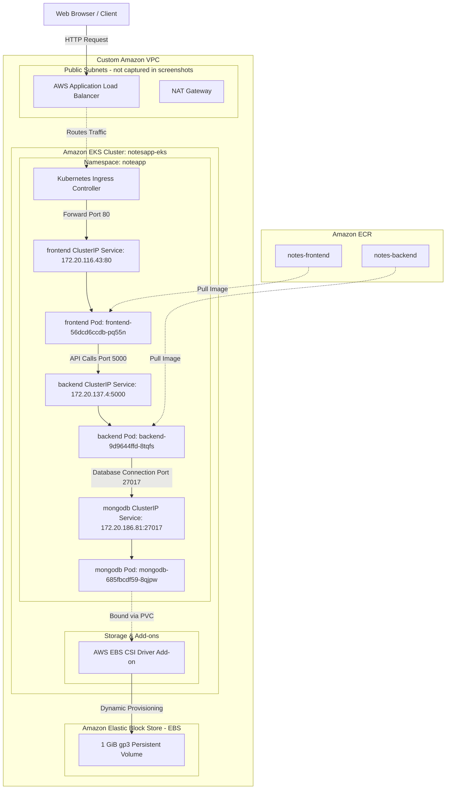
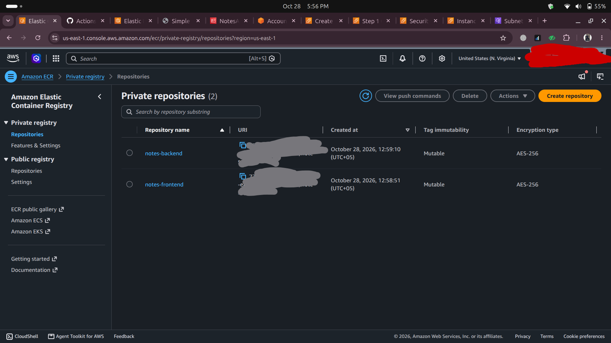
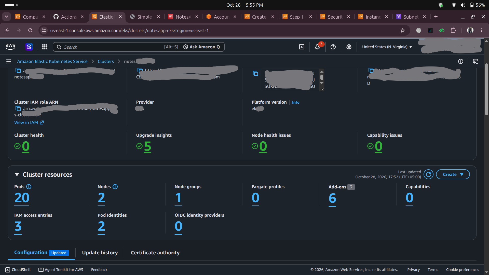
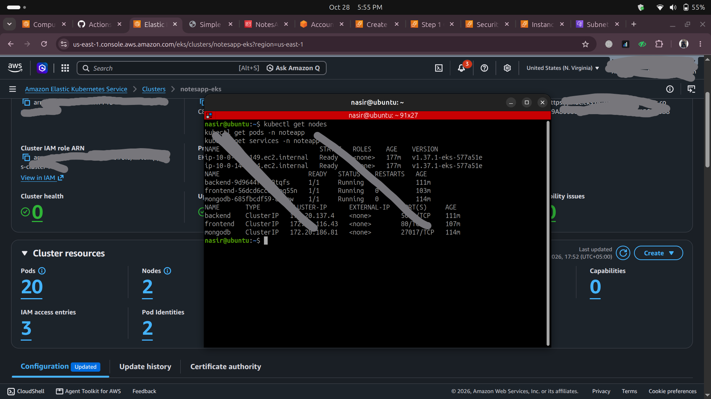
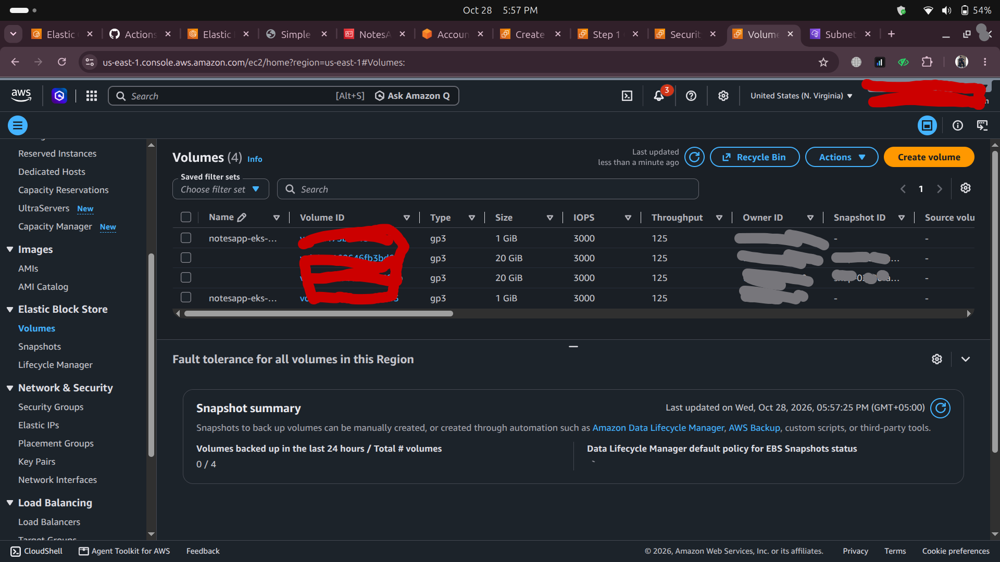
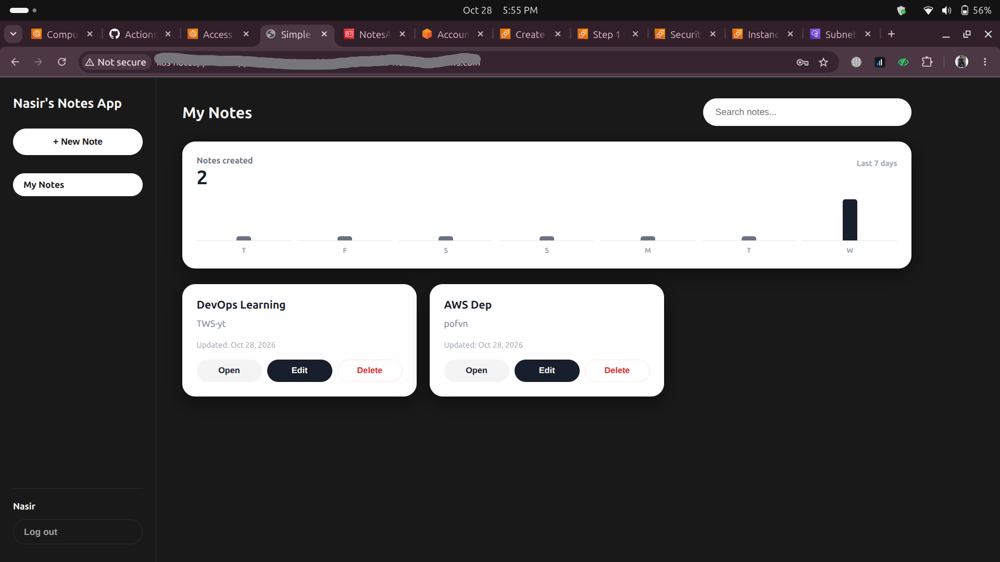

# Application Deployment on AWS EKS

A production-style cloud-native deployment of a three-tier Notes Web Application (React frontend, Node.js/Express backend, and MongoDB database) on Amazon Elastic Kubernetes Service (Amazon EKS). The cluster and supporting networking resources were created using the AWS Management Console and AWS CLI. The infrastructure demonstrates hands-on cloud delivery including Docker containerization, Amazon ECR image hosting, Kubernetes pod and service orchestration, persistent volume management via Amazon EBS and the AWS EBS CSI Driver, and public traffic routing through an AWS Application Load Balancer (ALB) managed by the AWS Load Balancer Controller.

---

## Tech Stack & AWS Services

- **Application Stack:** React frontend, Node.js & Express backend, MongoDB database
- **Containerization & Registries:** Docker (multi-stage builds), Amazon Elastic Container Registry (Amazon ECR)
- **Container Orchestration:** Amazon Elastic Kubernetes Service (Amazon EKS), Kubernetes Deployments, ClusterIP Services, Namespaces
- **Database & Persistent Storage:** MongoDB, Amazon Elastic Block Store (EBS gp3 volumes), AWS EBS CSI Driver, PersistentVolumeClaims (PVCs)
- **Networking & Cloud Infrastructure:** Amazon VPC, Public & Private Subnets, Route Tables, NAT Gateway, Internet Gateway
- **Ingress & Load Balancing:** AWS Load Balancer Controller, Kubernetes Ingress, AWS Application Load Balancer (ALB)
- **Security & IAM:** IAM roles and policies for cluster service accounts (IRSA), IAM add-on permissions, Security Groups

---

## Architecture

The following diagram illustrates the application and infrastructure flow based strictly on the deployed components visible in the AWS console and cluster verification outputs.

### Architecture Notes
- **VPC & Subnet Layout:** Specific CIDR blocks, subnet segmentation (public vs. private), and NAT Gateway routing tables were configured in AWS, but detailed routing tables/CIDRs are not captured in screenshots.
- **Ingress Specification:** Ingress annotations and target group bindings were provisioned via AWS Load Balancer Controller; the exact Ingress YAML manifest is not captured in screenshots.

---

## Deployment Walkthrough

### 1. Container Images in Amazon ECR
Application frontend and backend components were containerized using Docker and published to private Amazon ECR repositories with AES-256 server-side encryption.

*Amazon ECR console showing active private repositories `notes-backend` and `notes-frontend` hosted in `us-east-1` with mutable tag immutability and standard AES-256 encryption.*

---

### 2. Amazon EKS Cluster Provisioning
An Amazon EKS cluster (`notesapp-eks`) was created using the AWS Management Console / CLI with platform version `eks.5`, associated with an IAM cluster role (`notesapp-eks-cluster-role`), and configured with 2 worker nodes across 1 managed node group.

*Amazon EKS console showing active cluster `notesapp-eks` in `us-east-1` running 2 worker nodes, 20 cluster pods, 6 add-ons (including EBS CSI and VPC CNI), and 2 pod identities.*

---

### 3. Workload Verification & Cluster Networking
The application workloads were deployed into the dedicated `noteapp` namespace, exposing internal ClusterIP services for modular inter-pod communication.

*CLI terminal output confirming 2 Ready nodes (`ip-10-0-140-149` and `ip-10-0-144-224`), 3 Running application pods (`backend`, `frontend`, `mongodb`), and 3 active ClusterIP services in the `noteapp` namespace.*

---

### 4. Persistent Storage with Amazon EBS CSI Driver
Persistent data storage for MongoDB was configured using dynamic PersistentVolumeClaims (PVCs) backed by the AWS EBS CSI Driver, automatically provisioning gp3 EBS volumes.

*Amazon EC2 Elastic Block Store (EBS) console showing 4 active gp3 volumes in `us-east-1`: two 1 GiB dynamically provisioned volumes for Kubernetes PVC workloads alongside two 20 GiB node root volumes.*

---

### 5. Public Application Access via AWS Application Load Balancer
Public internet traffic is routed to the application frontend through an AWS Application Load Balancer provisioned by the AWS Load Balancer Controller.

*Notes Web App running live in Google Chrome accessed through the AWS ALB endpoint, showing user "Nasir" authenticated with notes dashboard and active CRUD operations.*

---

## Verification & Manual Testing

The deployment was manually tested and verified end-to-end:
1. **Public Connectivity:** Confirmed public access through the provisioned Application Load Balancer DNS endpoint across standard HTTP ports.
2. **User Authentication:** Successfully performed new user registration and session login through the React/Web frontend.
3. **Database Operations (CRUD):** Created new notes ("DevOps Learning", "AWS Dep"), edited existing entries, and validated persistence across MongoDB pod lifecycles using persistent EBS storage.

---

## What I Learned & Planned Improvements

This hands-on deployment provided in-depth practical experience with Kubernetes primitives on AWS, particularly configuring IAM roles for service accounts (IRSA), configuring EBS CSI storage classes, and reconciling Ingress objects with AWS Load Balancers.

### Planned Improvements (Not Yet Implemented):
- **Infrastructure as Code (IaC):** Provision the entire VPC, subnets, EKS cluster, and IAM policies automatically using **Terraform** or **AWS CloudFormation** rather than manual console/CLI steps.
- **Automated CI/CD:** Establish an automated pipeline using **GitHub Actions** and declarative GitOps via **Argo CD** to build, scan, and deploy updates on git push.
- **Observability:** Deploy cluster-wide monitoring using **Prometheus** and **Grafana** dashboards to track pod metrics, CPU/memory limits, and node health.
- **Security & TLS/HTTPS:** Attach a custom domain with **AWS Certificate Manager (ACM)** to enforce HTTPS/TLS termination at the Application Load Balancer with strict HTTP security headers.
